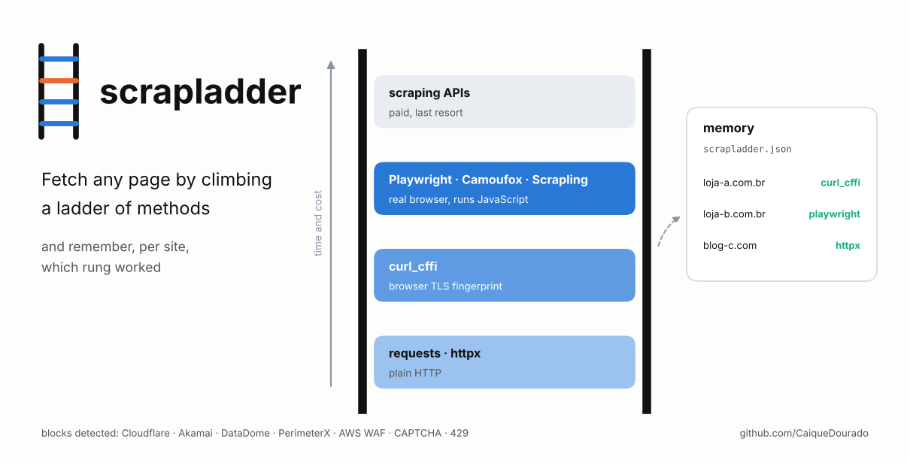
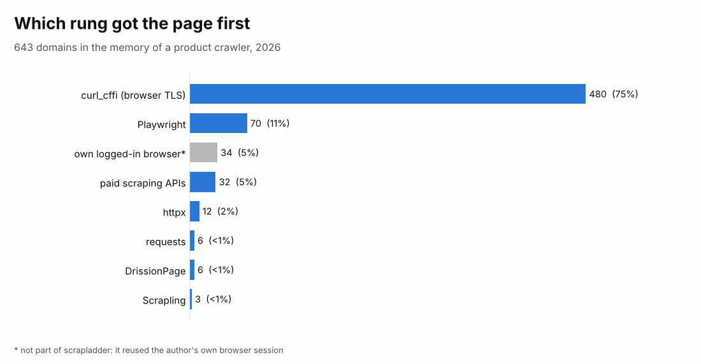
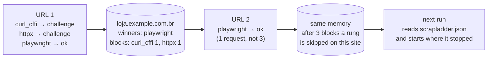
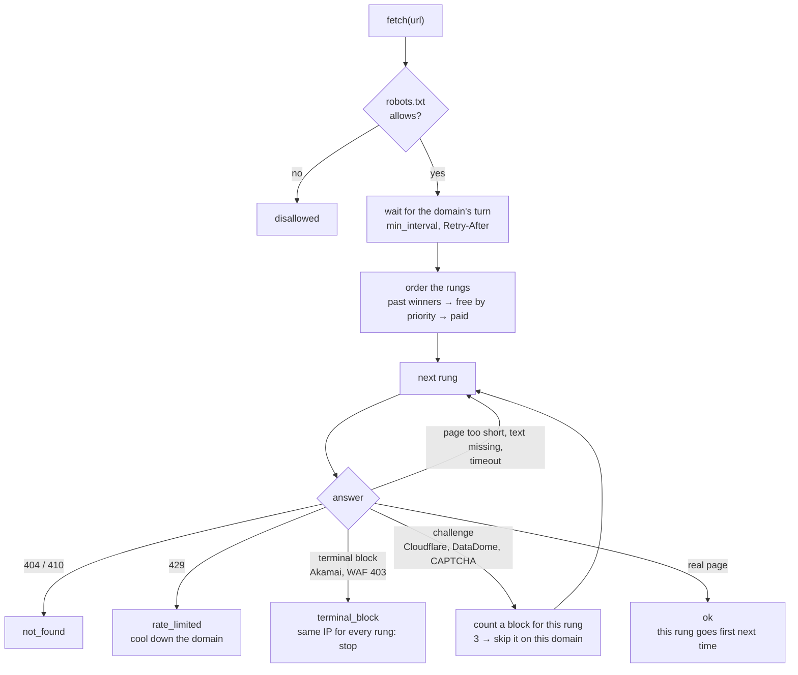

# scrapladder

[](https://github.com/CaiqueDourado/scrapladder/actions/workflows/tests.yml)
[](LICENSE)
[](pyproject.toml)

[Leia em português](README.pt-BR.md)



Fetch a web page by climbing a ladder of methods, from the cheapest to the heaviest, and **remember per domain which rung worked**:

1. plain HTTP (`requests`, `httpx`);
2. HTTP with a real browser's TLS fingerprint (`curl_cffi`);
3. headless browsers (Playwright, Camoufox, Scrapling);
4. paid scraping APIs (ScraperAPI, ScrapingBee, ScrapingDog, Scrape.do) as the last resort.

The next URL of the same site starts at the rung that worked last time. It skips rungs that were blocked three times there.

```python
from scrapladder import Ladder

with Ladder(memory="scrapladder.json") as ladder:
    r = ladder.fetch("https://loja.example.com.br/produto/123", must_contain="KZ ZSN Pro")

if r.ok:
    print(r.method, len(r.html))   # e.g. curl_cffi 184213
else:
    print(r.summary())             # e.g. blocked via - [curl_cffi:challenged(cloudflare_challenge) > playwright:challenged(...)]
```

## Where it comes from

The ladder is the fetch layer of the crawler behind the author's product-review site, which reads manufacturer pages, reviews and the prices of Brazilian and international stores. Each site behaves differently:

- some answer anything;
- some answer `403` to any Python client whose TLS handshake does not look like a browser's;
- some only show the content after JavaScript runs;
- some stop every automated client at the CDN.

Trying every method on every URL is slow and expensive. Hard-coding a method per site breaks the day the site changes.

So the crawler learned. Its memory ended up with 643 domains. The chart shows which method got the page first on each one:



- **curl_cffi** got the page on 480 domains (75%). Most "blocks" were only about the TLS fingerprint.
- **Playwright** was needed on 70 domains (11%), the sites that render with JavaScript.
- **Paid APIs** were the answer on 32 domains (5%). Keeping them last kept the bill small.

Caveat on these numbers: the crawler tried `curl_cffi` before `httpx` and `requests`, so they show which rung was enough, not that plain HTTP would have failed. The grey bar is a method the crawler had and this library does not include: it drove the author's own logged-in browser.

### What production says

The memory only keeps the winner. The crawler's database keeps every page it saved, so it shows more.

**Web pages for product research** (reviews, manufacturer pages, forums): 6,869 pages on 1,165 domains, September 2025 to August 2026.

| Method | Pages | Domains |
|---|---:|---:|
| Playwright | 2,018 (29%) | 385 |
| requests + BeautifulSoup (first version, until Oct 2025) | 1,799 (26%) | 392 |
| curl_cffi (ladder, since May 2026) | 1,616 (24%) | 463 |
| paid APIs (ScraperAPI, ScrapingBee, Scrape.do, ScrapingDog) | 905 (13%) | — |
| author's logged-in browser (not in this library) | 270 (4%) | 23 |
| httpx, DrissionPage, requests | 259 (4%) | — |

Of the 11,892 URLs that finished (web pages and videos), 11,639 (97.9%) got content, 119 (1.0%, on 36 domains) stayed blocked, and 35 were gone (404).

**Store prices** are harder: 9,847 price readings from product pages of Brazilian and international stores.

- **curl_cffi** got 25% of them.
- **requests** and **httpx** together got 11%.
- **Browsers** (Scrapling, DrissionPage) got 9%.
- **Paid APIs** got 7%.
- **The author's own logged-in browser** got 43%: the big marketplaces. This library does not do that, so expect those sites to end in `blocked` or in a paid API.

## How it works

What the memory learns on one site, URL after URL:



What happens to each URL:



| Rung | Package | Priority | Use |
|---|---|---|---|
| `curl_cffi` | `curl_cffi` | 0.8 | HTTP with the TLS/HTTP2 fingerprint of Chrome (`impersonate`) |
| `httpx` | `httpx` (+`h2` for HTTP/2) | 0.65 | plain HTTP |
| `requests` | `requests` | 0.6 | plain HTTP |
| `playwright` | `playwright` | 0.4 | Chromium, runs JavaScript |
| `scrapling` | `scrapling` | 0.3 | Scrapling's `StealthyFetcher` |
| `camoufox` | `camoufox` | 0.3 | Firefox with an ordinary user's fingerprint |
| `scrapedo`, `scrapingdog`, `scrapingbee`, `scraperapi` | `requests` + API key | 0.1, paid | their IPs and browsers, billed per request |

**Order.** The domain's past winners go first. The free rungs follow, sorted by a priority learned across all domains (moving average of the last results, blended with the default above). Paid rungs come last unless one of them already won on that domain.

**Block detection** ([`blocks.py`](src/scrapladder/blocks.py)) reads the status, the headers and the top of the HTML. It sorts what it finds into three kinds:

| Kind | Examples | Decision |
|---|---|---|
| `terminal` | Akamai "Access Denied … edgesuite.net", short "403 Forbidden" page, Imperva incident, Sucuri | stop: every rung leaves from the same IP |
| `challenge` | Cloudflare (`cf-mitigated`, "Just a moment…"), DataDome, PerimeterX, AWS WAF, reCAPTCHA/hCaptcha, "não é um robô" | count a block for this rung, try the next |
| `rate_limited` | HTTP 429, "too many requests" | stop, respect `Retry-After` |

Only the first 8,000 characters are read. A real page that says "too many requests" somewhere in its scripts is not a block page.

**Content checks.** A rung that answers 200 has not necessarily got the page. These checks reject the answer and move to the next rung:

- `min_length` (default 500 characters);
- `must_contain`: the product name, for example. It catches a redirect to the home page or a "product not found" page;
- `accept(html)`: your own check.

**Politeness.**
- `min_interval` (default 4 s) between requests to the same domain.
- A 429 stops the ladder and cools the domain down for its `Retry-After`. If the wait is longer than `max_wait`, `fetch` returns `rate_limited` with `retry_after` instead of sleeping.
- robots.txt is read by default (`respect_robots=False` to turn it off).

**Memory.** A readable JSON file holds the winners and block counters per domain and the statistics per method. It is written atomically. The older format `{"domain": ["method", ...]}` is read too.

## Install

```bash
pip install "scrapladder[all] @ git+https://github.com/CaiqueDourado/scrapladder"
playwright install chromium           # for the browser rung
pip install "scrapladder[camoufox]"   # optional
pip install "scrapladder[scrapling]"  # optional
```

The extras are `http`, `curl`, `browser`, `camoufox` and `scrapling`; `all` bundles the first three. Rungs whose package or API key is missing are left out. `scrapladder methods` lists what is available.

## Command line

```bash
scrapladder methods                                   # which rungs are installed
scrapladder explain https://loja.example.com.br/p/1   # try EVERY rung, one line each
scrapladder fetch https://loja.example.com.br/p/1 --memory scrapladder.json -o page.html
scrapladder stats --memory scrapladder.json           # which rung wins on how many domains
```

`explain` is the tool for a new site: one table with the outcome, status, size, time and block reason of each rung. Example (illustrative):

```text
method       outcome         status      size    sec  reason
curl_cffi    ok                 200    184213    0.6
httpx        challenged         403      5871    0.3  cloudflare_challenge
requests     challenged         403      5871    0.2  cloudflare_challenge
playwright   ok                 200    402551    4.1
```

## Your own rung

```python
from scrapladder import Ladder
from scrapladder.methods import Method, Response, default_methods

class MyProxyApi(Method):
    name, default_priority, paid = "myproxy", 0.2, True

    def fetch(self, url):
        r = my_client.get(url)
        return Response(r.status, r.text, r.headers, r.url)

ladder = Ladder([*default_methods(), MyProxyApi()])
```

## Scope

scrapladder chooses between existing, public tools. It does not:

- reuse cookies or the profile of your own browser;
- log in to sites;
- solve CAPTCHAs. A CAPTCHA is reported as a `challenge` and the ladder moves on.

Options of the backends (for example Scrapling's `fetch_options`, Camoufox's `options`) are passed through as given. What you fetch, how often and under which terms is your responsibility.

## Limits

- The sync Playwright API is not thread-safe: use one `Ladder` per thread.
- The block signatures are text and headers; vendors change their pages. `explain` and the `reason` of each attempt show when a signature is missing; contributions are welcome.
- Priorities learn across all domains together; a rung that is great on one site and bad on many others drifts down globally, but the domain's own winners still put it first there.

## Related

- [llm-cost-kit](https://github.com/CaiqueDourado/llm-cost-kit): what each LLM call really cost, from the same crawler.
- [transcriptladder](https://github.com/CaiqueDourado/transcriptladder): the same ladder for YouTube transcripts (captions first, speech recognition last).
- [BrCommerceKit](https://github.com/CaiqueDourado/BrCommerceKit): detect the e-commerce platform of a Brazilian store and read its product feed (a feed, when there is one, is cheaper than any rung).
- [lojas-virtuais-brasil](https://github.com/CaiqueDourado/lojas-virtuais-brasil): 63,974 Brazilian online stores with their platform.

## License

[MIT](LICENSE) © Caique Dourado
