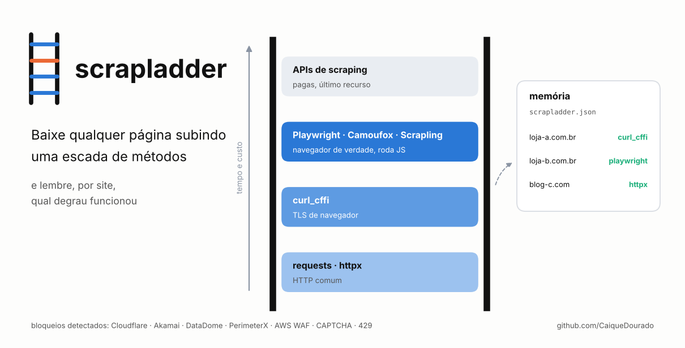
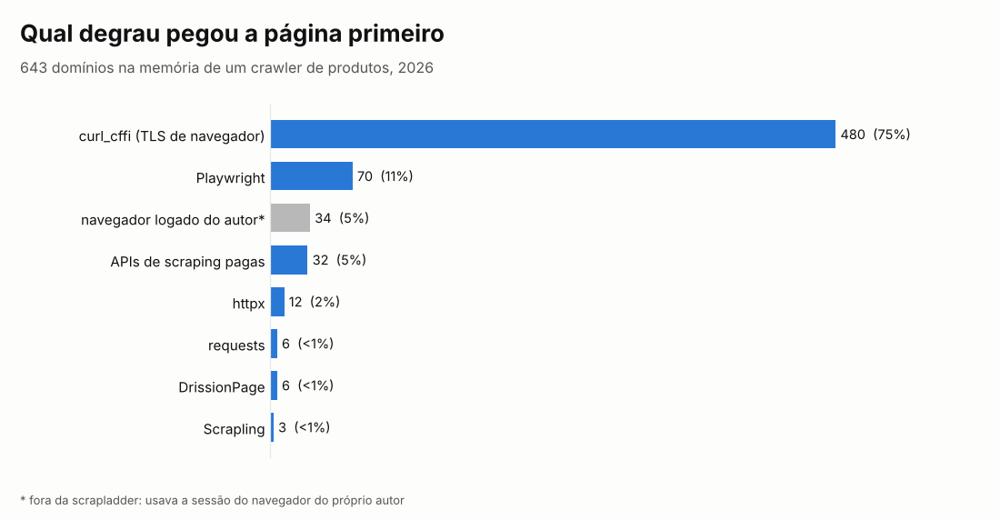
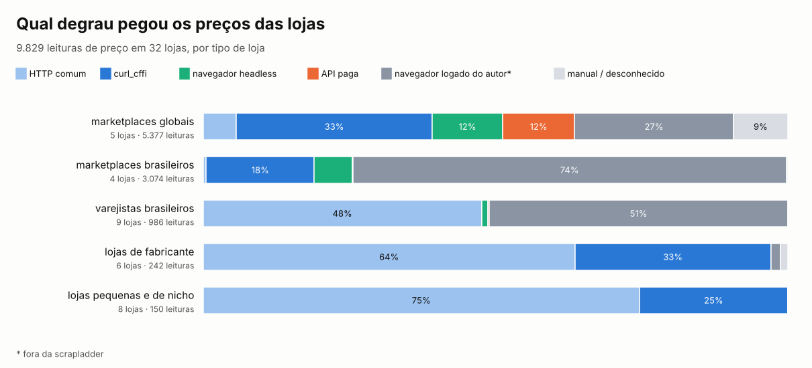
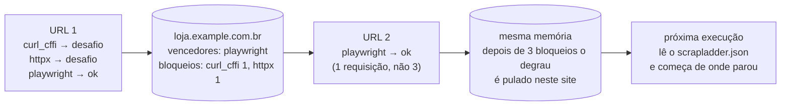
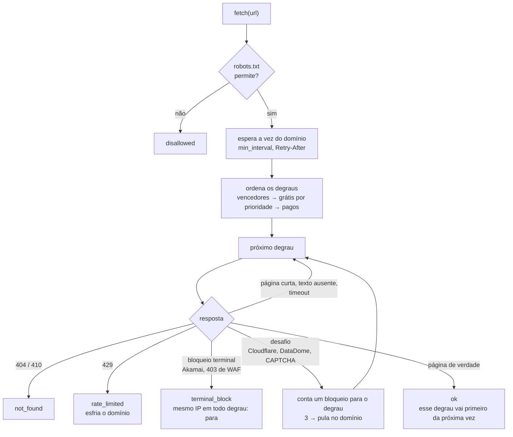

# scrapladder

[](https://github.com/CaiqueDourado/scrapladder/actions/workflows/tests.yml)
[](LICENSE)
[](pyproject.toml)

[Read in English](README.md)



Baixa uma página subindo uma escada de métodos, do mais barato ao mais pesado, e **lembra, por domínio, qual degrau funcionou**:

1. HTTP comum (`requests`, `httpx`);
2. HTTP com a impressão digital TLS de um navegador de verdade (`curl_cffi`);
3. navegadores headless (Playwright, Camoufox, Scrapling);
4. APIs de scraping pagas (ScraperAPI, ScrapingBee, ScrapingDog, Scrape.do) como último recurso.

A próxima URL do mesmo site começa no degrau que funcionou da última vez. Degraus bloqueados três vezes naquele site são pulados.

```python
from scrapladder import Ladder

with Ladder(memory="scrapladder.json") as ladder:
    r = ladder.fetch("https://loja.example.com.br/produto/123", must_contain="KZ ZSN Pro")

if r.ok:
    print(r.method, len(r.html))   # ex.: curl_cffi 184213
else:
    print(r.summary())             # ex.: blocked via - [curl_cffi:challenged(cloudflare_challenge) > playwright:challenged(...)]
```

## De onde vem

A escada é a camada de coleta do crawler por trás do site de análises de produtos do autor. Esse crawler lê páginas de fabricantes, reviews e preços de lojas brasileiras e de fora. Cada site se comporta de um jeito:

- uns respondem a qualquer cliente;
- outros devolvem `403` para todo cliente Python cujo handshake TLS não parece de navegador;
- outros só mostram o conteúdo depois que o JavaScript roda;
- outros param todo cliente automatizado já na CDN.

Testar todos os métodos em toda URL é lento e caro. Fixar um método por site quebra no dia em que o site muda.

Então o crawler passou a aprender. A memória dele chegou a 643 domínios. O gráfico mostra qual método pegou a página primeiro em cada um:



- **curl_cffi** pegou a página em 480 domínios (75%). A maior parte dos "bloqueios" era só a impressão digital TLS.
- **Playwright** foi necessário em 70 domínios (11%), os sites que montam a página com JavaScript.
- **APIs pagas** resolveram 32 domínios (5%). Deixá-las por último manteve a conta baixa.

Ressalva sobre esses números: o crawler tentava `curl_cffi` antes de `httpx` e `requests`, então eles mostram qual degrau bastou, não que o HTTP comum teria falhado. A barra cinza é um método que o crawler tinha e esta biblioteca não inclui: ele usava o navegador do próprio autor, logado.

### O que a produção mostra

A memória só guarda o vencedor. O banco do crawler guarda cada página salva, então mostra mais.

**Páginas para pesquisa de produto** (reviews, sites de fabricante, fóruns): 6.869 páginas em 1.165 domínios, de setembro de 2025 a agosto de 2026.

| Método | Páginas | Domínios |
|---|---:|---:|
| Playwright | 2.018 (29%) | 385 |
| requests + BeautifulSoup (primeira versão, até out. 2025) | 1.799 (26%) | 392 |
| curl_cffi (escada, desde maio de 2026) | 1.616 (24%) | 463 |
| APIs pagas (ScraperAPI, ScrapingBee, Scrape.do, ScrapingDog) | 905 (13%) | — |
| navegador logado do autor (fora desta biblioteca) | 270 (4%) | 23 |
| httpx, DrissionPage, requests | 259 (4%) | — |

Das 11.892 URLs que terminaram (páginas e vídeos), 11.639 (97,9%) tiveram conteúdo, 119 (1,0%, em 36 domínios) ficaram bloqueadas e 35 não existiam mais (404).

**Preços de loja** são mais difíceis: 9.847 leituras de preço em páginas de produto de lojas brasileiras e de fora.

- **curl_cffi** pegou 25% delas.
- **requests** e **httpx** juntos pegaram 11%.
- **Navegadores** (Scrapling, DrissionPage) pegaram 9%.
- **APIs pagas** pegaram 7%.
- **O navegador logado do próprio autor** pegou 43%: os grandes marketplaces. Esta biblioteca não faz isso, então nesses sites espere `blocked` ou uma API paga.

O tipo de loja decide o degrau mais do que qualquer outra coisa:



- **Lojas de fabricante e lojas pequenas**: HTTP comum ou curl_cffi pegaram todos os preços. Nunca foi preciso navegador.
- **Varejistas brasileiros**: metade das leituras veio com HTTP comum. A outra metade são três grandes varejistas que só responderam ao navegador logado do autor.
- **Marketplaces brasileiros**: 74% só pelo navegador logado. O curl_cffi pegou o site de classificados, com 24 subdomínios regionais.
- **Marketplaces globais** usaram todos os degraus: curl_cffi em um terço, navegador headless e APIs pagas em 12% cada.

Loja por loja (uma leitura é um preço gravado quando mudou; URLs são páginas de produto com pelo menos um preço):

| Loja | Tipo | Leituras | URLs | HTTP comum | curl_cffi | Navegador headless | API paga | Navegador do autor | Manual / desconhecido |
|---|---|---:|---:|---:|---:|---:|---:|---:|---:|
| Amazon | marketplace global | 2.972 | 840 | 300 | 1.798 | 43 | 238 | 190 | 403 |
| Mercado Livre | marketplace brasileiro | 1.565 | 814 | 17 |  | 164 | 3 | 1.379 | 2 |
| AliExpress | marketplace global | 1.197 | 367 |  |  | 274 | 12 | 871 | 40 |
| Shopee | marketplace brasileiro | 816 | 472 |  |  |  |  | 816 |  |
| eBay | marketplace global | 766 | 415 | 7 | 2 | 56 | 371 | 320 | 10 |
| OLX | marketplace brasileiro | 573 | 498 |  | 568 |  |  |  | 5 |
| Alibaba | marketplace global | 396 | 304 |  |  | 277 | 38 | 37 | 44 |
| Kabum! | varejista brasileiro | 281 | 195 | 281 |  |  |  |  |  |
| Magazine Luiza | varejista brasileiro | 194 | 106 |  |  |  |  | 194 |  |
| Casas Bahia | varejista brasileiro | 170 | 126 |  |  |  |  | 170 |  |
| KZ Music Store | loja de fabricante | 134 | 89 | 132 |  |  |  |  | 2 |
| Ponto Frio | varejista brasileiro | 123 | 93 |  |  |  |  | 123 |  |
| Enjoei | marketplace brasileiro | 120 | 101 |  |  | 35 |  | 85 |  |
| FastShop | varejista brasileiro | 111 | 73 | 111 |  |  |  |  |  |
| Carrefour | varejista brasileiro | 71 | 46 | 71 |  |  |  |  |  |
| Samsung | loja de fabricante | 60 | 58 |  | 56 |  |  | 4 |  |
| Banggood | marketplace global | 46 | 17 |  |  |  |  | 46 |  |
| The Space Music | loja pequena | 46 | 46 | 46 |  |  |  |  |  |
| iPlace | loja pequena | 38 | 27 |  | 38 |  |  |  |  |
| Timbres AVT | loja pequena | 34 | 8 | 34 |  |  |  |  |  |
| Bemol | varejista brasileiro | 26 | 26 |  |  | 10 |  | 16 |  |
| KZ Acoustics | loja de fabricante | 23 | 23 | 22 | 1 |  |  |  |  |
| Apple | loja de fabricante | 21 | 13 |  | 21 |  |  |  |  |
| Linsoul | loja pequena | 13 | 13 | 13 |  |  |  |  |  |
| Porão Musical | loja pequena | 12 | 5 | 12 |  |  |  |  |  |
| WebContinental | varejista brasileiro | 9 | 3 | 7 |  |  | 2 |  |  |
| LBBAIXO | vendedor no WhatsApp | 9 | 9 |  |  |  |  |  | 9 |
| Ez Music Store | vendedor no WhatsApp | 8 | 8 |  |  |  |  |  | 8 |
| KZ Headphones | loja de fabricante | 3 | 3 |  | 3 |  |  |  |  |
| BLACKCINZA | loja pequena | 3 | 3 | 3 |  |  |  |  |  |
| Mac Switch | loja pequena | 3 | 3 | 3 |  |  |  |  |  |
| Ri Happy | varejista brasileiro | 1 | 1 |  |  | 1 |  |  |  |
| Infogama | loja pequena | 1 | 1 | 1 |  |  |  |  |  |
| Music in Ear's Store | vendedor no WhatsApp | 1 | 1 |  |  |  |  |  | 1 |
| Google Store | loja de fabricante | 1 | 1 |  |  |  |  |  | 1 |

## Como funciona

O que a memória aprende num site, URL após URL:



O que acontece com cada URL:



| Degrau | Pacote | Prioridade | Para quê |
|---|---|---|---|
| `curl_cffi` | `curl_cffi` | 0,8 | HTTP com a impressão TLS/HTTP2 do Chrome (`impersonate`) |
| `httpx` | `httpx` (+`h2` para HTTP/2) | 0,65 | HTTP comum |
| `requests` | `requests` | 0,6 | HTTP comum |
| `playwright` | `playwright` | 0,4 | Chromium, roda JavaScript |
| `scrapling` | `scrapling` | 0,3 | `StealthyFetcher` do Scrapling |
| `camoufox` | `camoufox` | 0,3 | Firefox com impressão digital de usuário comum |
| `scrapedo`, `scrapingdog`, `scrapingbee`, `scraperapi` | `requests` + chave da API | 0,1, pago | IPs e navegadores deles, cobrado por requisição |

**Ordem.** Os vencedores do domínio vão primeiro. Depois vêm os degraus grátis, ordenados por uma prioridade aprendida em todos os domínios (média móvel dos últimos resultados, misturada com o padrão acima). Os pagos ficam por último, a menos que um deles já tenha vencido naquele domínio.

**Detecção de bloqueio** ([`blocks.py`](src/scrapladder/blocks.py)). Lê o status, os cabeçalhos e o começo do HTML, e separa o que encontra em três tipos:

| Tipo | Exemplos | Decisão |
|---|---|---|
| `terminal` | Akamai "Access Denied … edgesuite.net", página curta "403 Forbidden", incidente Imperva, Sucuri | para: todo degrau sai do mesmo IP |
| `challenge` | Cloudflare (`cf-mitigated`, "Just a moment…"), DataDome, PerimeterX, AWS WAF, reCAPTCHA/hCaptcha, "não é um robô" | conta um bloqueio para o degrau e tenta o próximo |
| `rate_limited` | HTTP 429, "too many requests" | para e respeita o `Retry-After` |

Só os primeiros 8.000 caracteres são lidos. Uma página de verdade que tem "too many requests" em algum script não é página de bloqueio.

**Checagens de conteúdo.** Um degrau que responde 200 não necessariamente pegou a página. Estas checagens recusam a resposta e passam para o próximo degrau:

- `min_length` (padrão: 500 caracteres);
- `must_contain`: o nome do produto, por exemplo. Pega o redirecionamento para a home ou a página "produto não encontrado";
- `accept(html)`: a sua própria checagem.

**Educação.**
- `min_interval` (padrão: 4 s) entre requisições ao mesmo domínio.
- Um 429 para a escada e esfria o domínio pelo tempo do `Retry-After`. Se a espera passar de `max_wait`, o `fetch` devolve `rate_limited` com `retry_after` em vez de dormir.
- O robots.txt é lido por padrão (`respect_robots=False` desliga).

**Memória.** Um JSON legível guarda os vencedores e os contadores de bloqueio de cada domínio e as estatísticas de cada método. É gravado de forma atômica. O formato antigo, `{"domínio": ["método", ...]}`, também é lido.

## Instalação

```bash
pip install "scrapladder[all] @ git+https://github.com/CaiqueDourado/scrapladder"
playwright install chromium           # para o degrau de navegador
pip install "scrapladder[camoufox]"   # opcional
pip install "scrapladder[scrapling]"  # opcional
```

Os extras são `http`, `curl`, `browser`, `camoufox` e `scrapling`; `all` junta os três primeiros. Degraus sem o pacote ou sem a chave da API ficam de fora. `scrapladder methods` mostra o que está disponível.

## Linha de comando

```bash
scrapladder methods                                   # quais degraus estão instalados
scrapladder explain https://loja.example.com.br/p/1   # testa TODOS os degraus, uma linha cada
scrapladder fetch https://loja.example.com.br/p/1 --memory scrapladder.json -o pagina.html
scrapladder stats --memory scrapladder.json           # qual degrau vence em quantos domínios
```

O `explain` é a ferramenta para um site novo: uma tabela com resultado, status, tamanho, tempo e motivo do bloqueio de cada degrau. Exemplo (ilustrativo):

```text
method       outcome         status      size    sec  reason
curl_cffi    ok                 200    184213    0.6
httpx        challenged         403      5871    0.3  cloudflare_challenge
requests     challenged         403      5871    0.2  cloudflare_challenge
playwright   ok                 200    402551    4.1
```

## Um degrau seu

```python
from scrapladder import Ladder
from scrapladder.methods import Method, Response, default_methods

class MinhaApiDeProxy(Method):
    name, default_priority, paid = "meuproxy", 0.2, True

    def fetch(self, url):
        r = meu_cliente.get(url)
        return Response(r.status, r.text, r.headers, r.url)

ladder = Ladder([*default_methods(), MinhaApiDeProxy()])
```

## Escopo

A scrapladder escolhe entre ferramentas públicas que já existem. Ela não:

- reaproveita cookies nem o perfil do seu navegador;
- faz login em sites;
- resolve CAPTCHA. Um CAPTCHA é registrado como `challenge` e a escada segue para o próximo degrau.

As opções dos backends (por exemplo `fetch_options` do Scrapling e `options` do Camoufox) são repassadas como vierem. O que você coleta, com que frequência e sob quais termos é responsabilidade sua.

## Limites

- A API síncrona do Playwright não é thread-safe: use uma `Ladder` por thread.
- As assinaturas de bloqueio são texto e cabeçalhos, e os fornecedores mudam as páginas deles. O `explain` e o `reason` de cada tentativa mostram quando falta uma assinatura; contribuições são bem-vindas.
- As prioridades aprendem com todos os domínios juntos. Um degrau ótimo em um site e ruim em muitos outros cai na ordem geral, mas os vencedores do próprio domínio ainda o colocam primeiro lá.

## Relacionados

- [llm-cost-kit](https://github.com/CaiqueDourado/llm-cost-kit): quanto cada chamada de LLM custou de verdade, do mesmo crawler.
- [transcriptladder](https://github.com/CaiqueDourado/transcriptladder): a mesma escada para transcrições do YouTube (legenda primeiro, reconhecimento de fala por último).
- [BrCommerceKit](https://github.com/CaiqueDourado/BrCommerceKit): detecta a plataforma de uma loja brasileira e lê o feed de produtos dela (um feed, quando existe, sai mais barato que qualquer degrau).
- [lojas-virtuais-brasil](https://github.com/CaiqueDourado/lojas-virtuais-brasil): 63.974 lojas virtuais brasileiras com a plataforma de cada uma.

## Licença

[MIT](LICENSE) © Caique Dourado
